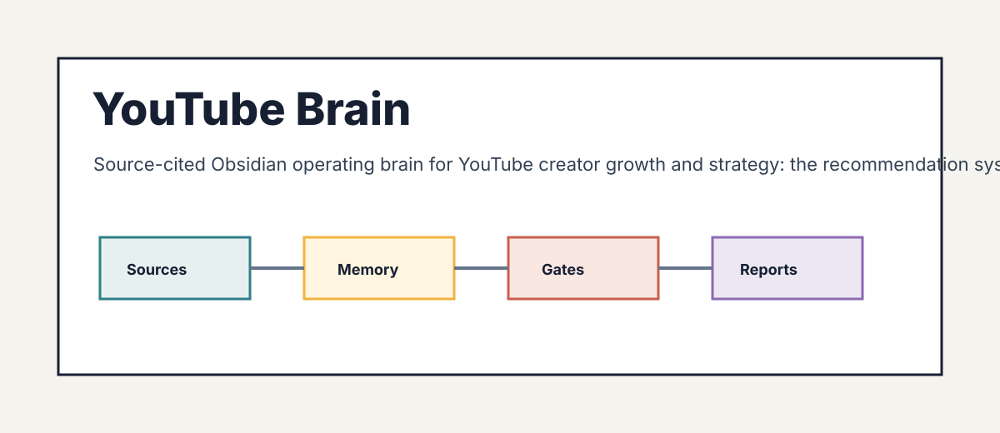

# YouTube Brain

<p align="center">
  
</p>

YouTube Brain is an evidence-gated Obsidian brain for YouTube creator growth and strategy: the recommendation system and discovery, subscriptions and audience, retention and average view duration, packaging (titles, thumbnails, click-through rate), Shorts versus long-form, publishing cadence, monetization (YouTube Partner Program, memberships, Supers, and Shopping), analytics interpretation, and community. It also covers two adjacent pillars: the developer APIs (Data, Analytics, Reporting, and Live Streaming) and paid advertising on YouTube through Google Ads.

**Current maturity:** market-ready. Research, domain adapters, demo verification,
audit, and release gates all pass; run `python scripts/audit_brain.py --require
market-ready` to confirm (score 100, no critical failures).

**Live docs:** https://agricidaniel.github.io/youtuber — the browsable site, built
from `wiki/` with Quartz.

> Unofficial, community-built. Not affiliated with, sponsored by, or endorsed by
> YouTube or Google LLC. "YouTube" and the YouTube play-button are trademarks of
> Google LLC.

It ships two artifacts:

- `assets/template-brain/` - the distributable Obsidian vault.
- `SKILL.md` plus `scripts/` - the agent-facing operating layer.

## Buyer

YouTube creators, channel managers, editors, and content strategists who need repeatable, source-cited decisions on what to make, how to package it, and how to grow and monetize a channel.

## Outputs

- Channel health scorecard (growth rate, AVD, CTR, RPM)
- Content performance analysis (top and bottom decile by watch time, CTR, subscriber attraction)
- Packaging audit (titles, thumbnails, click-through rate)
- Monetization audit (RPM opportunity, YouTube Partner Program gaps)
- Monthly optimization roadmap (A/B test plan and publishing cadence)

## Quick Start

```bash
python -m pip install -e .
youtube-brain demo
youtube-brain lint --vault examples/sample-vault
youtube-brain report --vault examples/sample-vault --html-only
```

To create a client vault:

```bash
youtube-brain new acme --client-name "Acme Co" --owner "Your Name" --out-dir ~/youtube-brain-vaults
youtube-brain ingest --vault ~/youtube-brain-vaults/acme --file tests/fixtures/sample-source.md
youtube-brain synthesize --vault ~/youtube-brain-vaults/acme
youtube-brain visuals --vault ~/youtube-brain-vaults/acme
youtube-brain report --vault ~/youtube-brain-vaults/acme --html-only
youtube-brain next --vault ~/youtube-brain-vaults/acme
```

## Boundaries

V1 is advisory and read-only. It does not mutate accounts, systems, books,
pipelines, publishing tools, customer records, or live production data.

Domain claims are release-blocked until `references/current-requirements.md`,
`references/market-research.md`, `references/source-map.md`, and
`references/source-ledger.json` contain dated source material from trustworthy
sources.

## Maturity Gates

1. Scaffolded: product shell, vault, source pack, scripts, tests, and demo exist.
2. Researched: dated trustworthy sources replace placeholder research.
3. Domain-adapted: real domain importer, synthesis, reports, fixtures, and tests exist.
4. Demo-verified: sample vault regenerates deterministically and reports cite sources.
5. Market-ready: audit score is at least 90 with no critical failures.

Scores are capped by maturity. A scaffold cannot become market-ready by edited
markdown alone.

## Research Policy

Use official, primary, or vendor documentation first. Use market or practitioner
sources only as supporting evidence. Do not treat blog roundups or AI summaries
as primary truth. Record evidence in `references/source-ledger.json`; prose-only
research notes do not satisfy the gate.

## Release

```bash
python scripts/package_release.py --version 0.1.0
python scripts/package_release.py --version 1.0.0 --release-type market-ready
```

Release packaging scans for secrets, local paths, symlinks, untracked drift,
and unsafe ZIP entries before writing `dist/RELEASE_MANIFEST.json` and
`dist/SHA256SUMS`. Market-ready packaging also runs `scripts/audit_brain.py`.


## Community

Built and maintained inside the AI Marketing Hub Pro community. Join, ask questions, and get the latest YouTube creator-growth playbooks at https://www.skool.com/ai-marketing-hub-pro
